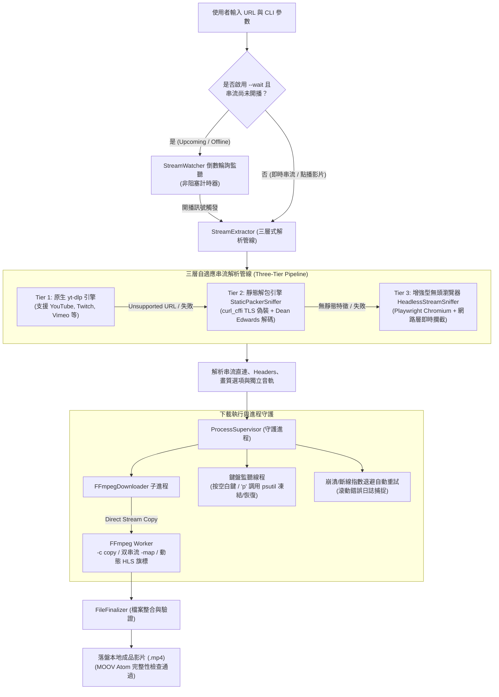

# PyStream-Downloader 智慧影音串流下載引擎

<p align="center">
  
  
  
  
  
  
</p>

> **PyStream-Downloader** 是一套專為現代串流生態設計的次世代影音下載與守護工具。深度結合 **yt-dlp**、**FFmpeg 無損重封裝**、**Dean Edwards Packer 靜態解包引擎**、**Playwright 無頭動態嗅探** 與 **psutil 進程控制**，提供全自動開播輪詢、Cloudflare 反爬蟲穿透、雙軌音畫同步混流、熱鍵凍結暫停與雙層自適應 Docker 容器化調度能力。

---

## 📑 目錄

- [系統架構圖](#-系統架構圖)
- [核心亮點與特色](#-核心亮點與特色)
- [三層式自適應解析管線](#-三層式自適應解析管線-three-tier-pipeline)
- [快速開始](#-快速開始)
  - [環境需求](#1-環境需求)
  - [本機裸機安裝](#2-本機裸機安裝)
  - [Docker 容器一鍵部署](#3-docker-容器一鍵部署推薦)
- [使用範例](#-使用範例)
  - [基本與進階操作](#1-基本與進階操作)
  - [一鍵調度腳本 (Windows / Linux)](#2-一鍵自適應調度腳本)
  - [Docker Compose 編排](#3-docker-compose-編排)
- [CLI 完整參數指南](#-cli-完整參數指南)
- [雙層容器規格矩陣](#-雙層容器規格矩陣-docker-profiles)
- [專案結構目錄](#-專案結構目錄)
- [自動化測試與瑕疵日誌](#-自動化測試與品質工程)
- [版本演進歷史](#-版本演進歷史)
- [開源授權](#-開源授權)

---

## 🏛 系統架構圖



---

## ✨ 核心亮點與特色

### ⚡ 三層式自適應解析管線 (Three-Tier Pipeline)
告別單一工具無法解析新興串流網站的困境：
- **Tier 1 (原生極速)**：主流網站（YouTube、Twitch 等）由 `yt-dlp` 高速解析。
- **Tier 2 (靜態混淆解包)**：針對 MissAV 等前端採用 Dean Edwards Packer (`p,a,c,k,e,d`) 混淆站點，透過純演算法還原 Base 10~62 混淆字串，搭配 `curl_cffi` 瀏覽器 TLS 指紋偽裝，**0.5 秒提取真實直鏈，100% 免疫 Cloudflare Turnstile 人機驗證，零開銷免啟動瀏覽器**。
- **Tier 3 (動態無頭嗅探)**：遇到高度動態渲染站點，自動回退啟動 Playwright 無頭 Chromium，注入 Stealth 特徵遮蔽並自動點擊激活 `<video preload="none">` 播放器，即時嗅探 m3u8/mpd 請求。

### 🎵 獨立音軌識別與雙串流混流 (Dual-Stream A/V Muxing)
- 徹底解決 YouTube 1080p+ 等 DASH 串流「視訊與音訊分離」導致下載影片無聲音的痛點。
- 智慧挑選最佳音軌（優先選取 AAC/m4a YouTube 140 軌，自動避開 DRC 壓縮音軌）。
- FFmpeg 雙輸入對齊混流（`-map 0:v:0 -map 1:a:0`），搭配 `+genpts`、`-avoid_negative_ts make_zero` 與 `aresample` 重採樣，確保音畫絕對同步。

### 🛡️ 進程生命週期守護與熱鍵凍結 (Process Supervisor)
- **即時暫停/恢復**：錄製過程中可隨時按下鍵盤「**空白鍵**」或「**p**」，調用 `psutil` 立即凍結/恢復 FFmpeg 進程，不浪費頻寬亦不中斷 TCP 連線。
- **斷線指數退避重試**：遇到網路瞬斷或 CDN 限流，自動以指數退避（2s, 4s, 8s...）重新連接，最多重試 5 次。
- **錯誤可視化滾動捕捉**：即時解析 FFmpeg stderr，過濾進度字串並快取異常退出訊息，徹底告別盲測排錯。

### 🐳 雙層自適應 Docker 容器架構
- **輕量版 (`slim`, ~420MB)**：秒級啟動，適合 95% 常見影音與靜態混淆網站。
- **完整版 (`full`, ~1.4GB)**：內建 Chromium 與 Linux 視窗相依函式庫，專攻需動態渲染之站點。
- **自適應晉升機制**：當輕量容器遇複雜動態站點時發送 **Exit Code 42**，調度腳本（`deploy.ps1` / `deploy.sh`）自動無縫重啟並升級為 full 容器接續執行。
- **現代 FFmpeg 7+ 相容**：自動動態偵測並注入 `-allowed_segment_extensions ALL` 與 `-extension_picky 0`，完美相容偽裝為 `.jpeg` 等圖片副檔名的分段串流。

### 🔒 企業級路徑與安全防護
- **CRLF 注入防禦**：嚴格檢驗 HTTP 標頭，杜絕換行符號注入攻擊。
- **Win32 MAX_PATH 防禦**：檔名清洗器整合字元數（80）與 UTF-8 位元組（180 bytes）雙重截斷，杜絕 Windows Docker 掛載點的長檔名報錯。
- **MP4 Box 原子結構檢查**：下載完成後自動驗證 `ftyp`、`moov`、`mdat` 區塊，確保影音檔案可正常播放。

---

## 🚀 三層式自適應解析管線 (Three-Tier Pipeline)

| 解析層級 | 負責模組 | 驅動技術 | 啟動耗時 | 記憶體開銷 | 適用場景 |
| :--- | :--- | :--- | :--- | :--- | :--- |
| **Tier 1: 原生解析** | `yt-dlp` | 內建 Extractor | ~1s | 極低 (~50MB) | YouTube, Twitch, Bilibili 等標準影音站點 |
| **Tier 2: 靜態混淆解包** | `StaticPackerSniffer` | `curl_cffi` + Dean Edwards Decoder | ~0.5s | 極低 (~80MB) | MissAV, Surrit 等 JS 混淆站點 (免疫 Turnstile) |
| **Tier 3: 動態無頭嗅探** | `HeadlessStreamSniffer` | Playwright Chromium + CDP Stealth | 5~15s | 較高 (~600MB) | 複雜 SPA、JS 動態加密載入、需點擊播放站點 |

---

## 📦 快速開始

### 1. 環境需求
- **Python**：3.10 以上 (建議 3.11 或 3.12)
- **FFmpeg**：系統 PATH 中需具備 `ffmpeg` 可執行檔 ([下載 FFmpeg](https://ffmpeg.org/download.html))
- **Docker** *(可選)*：Docker Desktop (Windows/macOS) 或 Docker Engine (Linux)

---

### 2. 本機裸機安裝

```bash
# 1. 複製專案庫
git clone https://github.com/YaruK1997/PyStream-Downloader.git
cd PyStream-Downloader

# 2. 建立並啟動虛擬環境 (推薦)
python -m venv venv
# Windows:
.\venv\Scripts\activate
# Linux/macOS:
source venv/bin/activate

# 3. 安裝基礎依賴 (Tier 1 + Tier 2，體積小秒裝)
pip install -r requirements.txt

# 4. (可選) 若需要 Tier 3 動態無頭嗅探支援，加裝 Playwright 與 Chromium：
pip install -r requirements-full.txt
playwright install chromium
```

---

### 3. Docker 容器一鍵部署 (推薦)

無須在本機配置 Python 或 FFmpeg，直接享受容器化環境：

```bash
# 輕量版映像檔建置 (約 420MB)
docker-compose build downloader

# 全功能版映像檔建置 (含 Playwright Chromium，約 1.4GB)
docker-compose --profile full build downloader-full
```

---

## 💡 使用範例

### 1. 基本與進階操作

#### 🎬 互動式下載 (自動呈現可用畫質選單)
```bash
python main.py "https://www.youtube.com/watch?v=dQw4w9WgXcQ"
```

#### 🎯 指定畫質與輸出目錄
```bash
python main.py "https://www.youtube.com/watch?v=dQw4w9WgXcQ" -q 1080p -o ./my_videos
```

#### ⏳ 監聽未開播串流 (開播即自動切入錄製)
```bash
python main.py "https://www.youtube.com/watch?v=upcoming_id" --wait --poll-interval 10
```

#### 🛡️ 反爬蟲與偽裝設定 (繞過 Cloudflare 阻擋)
```bash
# 偽裝為 Chrome 瀏覽器 TLS 指紋 (預設即為 chrome)
python main.py "https://target-stream.com/video" --impersonate chrome

# 從本機 Chrome 瀏覽器提取 Cookies 下載會員限定影片
python main.py "https://www.youtube.com/watch?v=members_only" --cookies-from-browser chrome
```

#### 🕵️ 串流嗅探模式控制
```bash
# 強制直接以無頭瀏覽器嗅探
python main.py "https://complex-spa.com/stream" --sniff always --sniff-timeout 20
```

---

### 2. 一鍵自適應調度腳本

調度腳本具備**「雙階段自適應晉升」**功能：先以輕量容器快速嘗試，遇需要 Chromium 渲染的動態站點自動晉升全功能容器，全程免人工干預。

#### Windows (PowerShell)
```powershell
# 互動式執行
.\deploy.ps1

# 指定 URL 與畫質
.\deploy.ps1 -Url "https://missav.ai/mukd-572" -Quality "720p"

# 強制直開全功能容器 (跳過輕量容器檢測)
.\deploy.ps1 -Url "https://target.com/video" -Full

# 僅編譯映像檔
.\deploy.ps1 -BuildOnly
```

#### Linux / macOS (Bash)
```bash
chmod +x deploy.sh

# 自適應下載
./deploy.sh "https://missav.ai/mukd-572" -q 720p

# 強制直開全功能容器
./deploy.sh --full "https://target.com/video"
```

---

### 3. Docker Compose 編排

```bash
# 1. 執行預設輕量容器 (~420MB)
docker-compose run --rm downloader "https://www.youtube.com/watch?v=xxxx" -q 1080p

# 2. 背景守護監聽開播 (無頭背景作業，停用熱鍵監聽)
docker-compose run --rm -d downloader "https://www.youtube.com/watch?v=xxxx" --wait --no-pause

# 3. 執行全功能 Chromium 容器 (~1.4GB)
docker-compose --profile full run --rm downloader-full "https://target.com/video"
```

> **檔案輸出位置**：所有下載影片預設皆透過 Docker Volume 即時落盤至主機的 `./downloads/` 目錄中。

---

## 🛠 CLI 完整參數指南

```text
usage: pystream-downloader [-h] [-v] [-q QUALITY] [-o OUTPUT] [--wait]
                           [--poll-interval POLL_INTERVAL]
                           [--max-retries MAX_RETRIES] [--no-pause]
                           [--impersonate IMPERSONATE]
                           [--cookies-from-browser COOKIES_FROM_BROWSER]
                           [--sniff {auto,always,never}]
                           [--sniff-timeout SNIFF_TIMEOUT]
                           [url]
```

| 參數名稱 | 縮寫 | 預設值 | 說明 |
| :--- | :---: | :---: | :--- |
| `url` | - | `None` | 目標影片、直播或串流網址 (未提供時將於終端互動提示輸入) |
| `--quality` | `-q` | `None` | 指定下載畫質，如 `1080p`、`720p`、`480p`、`best` (未指定時進入互動選單) |
| `--output` | `-o` | `./downloads` | 成品影片儲存目錄 |
| `--wait` | - | `False` | 啟用開播輪詢監聽 (若目標直播尚未開始，自動進入倒數輪詢等候) |
| `--poll-interval` | - | `15` | 開播輪詢間隔秒數 |
| `--max-retries` | - | `5` | 下載異常中斷時之最大自動重試次數 (指數退避間隔) |
| `--no-pause` | - | `False` | 停用鍵盤熱鍵暫停功能 (適用於背景 Daemon 或排程工作) |
| `--impersonate` | - | `chrome` | 啟用瀏覽器 TLS 指紋偽裝 (可設為 `chrome`、`firefox`、`safari` 或 `none`) |
| `--cookies-from-browser`| - | `None` | 自本機瀏覽器提取 Cookies (`chrome`, `edge`, `firefox`, `safari` 等) |
| `--sniff` | - | `auto` | 無頭瀏覽器嗅探模式 (`auto`: 遇未支援網站自動啟動; `always`: 強制啟用; `never`: 停用) |
| `--sniff-timeout` | - | `15` | 動態串流嗅探最長等待秒數 (下限為 5 秒) |
| `--version` | `-v` | - | 顯示目前版本號並結束程式 |
| `--help` | `-h` | - | 顯示說明訊息並結束程式 |

---

## 📊 雙層容器規格矩陣 (Docker Profiles)

| 映像檔服務 | Target | 映像檔體積 | 核心元件 | 啟動延遲 | 適用場景 |
| :--- | :---: | :---: | :--- | :---: | :--- |
| **`downloader`** *(預設)* | `slim` | ~420MB | Python + FFmpeg + yt-dlp + curl_cffi | 瞬時 (<1s) | 95% 主流網站、YouTube、Twitch、靜態混淆站點 (MissAV) |
| **`downloader-full`** | `full` | ~1.4GB | slim 組件 + Playwright Chromium + Linux GUI 相依庫 | ~3s | 需由瀏覽器執行高強度 JS 渲染、點擊互動解鎖之複雜網站 |

---

## 📂 專案結構目錄

```text
PyStream-Downloader/
├── .dockerignore               # Docker 忽略清單
├── .gitignore                  # Git 忽略清單
├── Dockerfile                  # 多階段構建 (slim & full targets)
├── docker-compose.yml          # 容器服務編排與代理透傳配置
├── deploy.ps1                  # Windows 一鍵部署與自適應調度腳本
├── deploy.sh                   # Linux/macOS 一鍵部署與自適應調度腳本
├── requirements.txt            # 基礎核心相依套件 (yt-dlp, psutil, curl_cffi)
├── requirements-full.txt       # 完整版動態嗅探相依套件 (playwright)
├── main.py                     # 應用程式進入點
├── src/                        # 核心業務邏輯原始碼
│   ├── __init__.py             # 套件初始化與版本聲明 (v1.5.1)
│   ├── cli.py                  # 命令列參數解析與互動選單
│   ├── downloader.py           # FFmpeg Worker 組裝與動態 HLS 旗標注入
│   ├── extractor.py            # 三層式串流提取器與音訊獨立匹配
│   ├── packer.py               # Dean Edwards Packer 靜態混淆解包演算法
│   ├── sniffer.py              # Playwright 動態無頭瀏覽器嗅探引擎
│   ├── static_sniffer.py       # TLS 偽裝靜態網頁抓取與串流直連萃取
│   ├── supervisor.py           # 進程守護、熱鍵凍結暫停與指數退避重試
│   ├── utils.py                # 檔名清洗、Win32 MAX_PATH 防禦、MP4 檢驗
│   └── watcher.py              # 開播輪詢監聽與倒數計時器
├── tests/                      # 單元與整合測試套件 (76 項全數通過)
│   ├── test_cli.py
│   ├── test_downloader.py
│   ├── test_extractor.py
│   ├── test_packer.py
│   ├── test_sniffer.py
│   ├── test_static_sniffer.py
│   ├── test_supervisor.py
│   ├── test_utils.py
│   └── test_watcher.py
├── tools/                      # 開發與品質工程輔助腳本
│   └── defect_logger.py        # 測試日誌截獲與結構化瑕疵工單生成器
└── docs/                       # 軟體生命週期規範文件
    ├── 01_spec.md              # 需求規格說明書 (PRD)
    ├── 02_architecture.md      # 系統架構設計說明書
    ├── 03_test_plan.md         # 測試計畫書
    ├── 04_test_report.md       # 測試驗收與瑕疵追蹤報告
    ├── 05_security_audit.md    # 資訊安全審查報告
    ├── 06_deployment_guide.md  # 容器化部署指南
    └── 07_changelog.md         # 版本異動軌跡紀錄
```

---

## 🧪 自動化測試與品質工程

本專案遵循嚴格的自動化測試規範，包含 76 項單元與整合測試，全面覆蓋解析器、解包器、守護進程、FFmpeg 命令注入防護與檔案系統相容性。

### 執行全套測試
```bash
python -m unittest discover -s tests -p "test_*.py"
```

### 瑕疵工單自動化流 (Defect Logger)
```bash
python tools/defect_logger.py
```
> 該工具會自動執行測試套件，並將失敗案例的堆疊軌跡、出錯檔案行號結構化記錄至 `.scratch/logs/defects.jsonl`，同時即時更新 [`docs/04_test_report.md`](docs/04_test_report.md)。

---

## 📈 版本演進歷史

- **v1.5.1 (2026-10-22)**：
  - 修正現代 FFmpeg 7+ 的 HLS 分段副檔名安全阻擋（動態注入 `-allowed_segment_extensions ALL` 與 `-extension_picky 0`）。
  - 修復 HLS 索引清單誤帶 `-reconnect_at_eof 1` 導致的無限重連掛死。
  - `sanitize_filename` 增加 UTF-8 位元組截斷（<= 180 bytes），杜絕 Windows Docker 掛載點 `MAX_PATH` 溢位。
  - `ProcessSupervisor` 補齊 stderr 錯誤字串滾動緩衝區與即時診斷輸出。
  - Docker Compose 補齊 `HTTP_PROXY` / `HTTPS_PROXY` / `ALL_PROXY` 代理透傳。
- **v1.5.0 (2026-10-22)**：重構三層式自適應解析管線，新增 `src/packer.py` 靜態 Dean Edwards Packer 解包引擎與 `src/static_sniffer.py`，0.5 秒極速還原串流直鏈，100% 免疫 Cloudflare Turnstile。
- **v1.4.1 (2026-10-22)**：Playwright CDP Locale 語系規範化與 Emulation 異常防禦降級。
- **v1.4.0 (2026-10-22)**：新增 YouTube 1080p+ 獨立音軌識別與 FFmpeg 雙流同步混流。
- **v1.3.0 (2026-10-21)**：推出雙層容器架構 (`slim` 與 `full`) 與 Exit Code 42 自適應升級機制。
- **v1.2.0 (2026-10-21)**：整合 Playwright 無頭 Chromium 動態串流嗅探器。
- **v1.1.0 (2026-10-21)**：整合 `curl_cffi` 瀏覽器 TLS 指紋偽裝與 CRLF 標頭注入防禦。
- **v1.0.0 (2026-10-21)**：核心發布，支援開播監聽輪詢、多畫質選擇、FFmpeg 直拷貝與熱鍵暫停。

完整異動紀錄請參閱 [docs/07_changelog.md](docs/07_changelog.md)。

---

## 📄 開源授權

本專案採用 [MIT License](LICENSE) 授權釋出。
